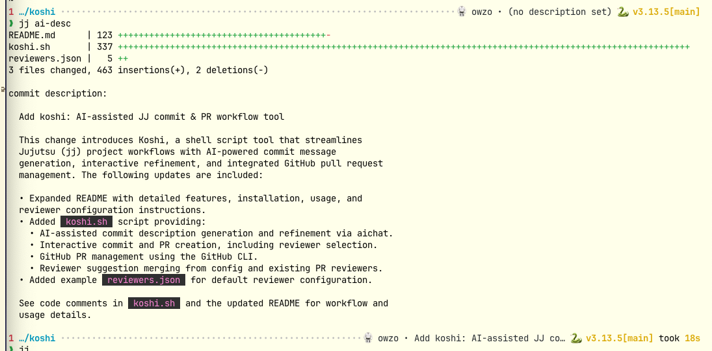

# Koshi

**Koshi** gives your [Jujutsu (jj)](https://github.com/jj-vcs/jj) projects a powerful lift with AI-assisted commit messages, interactive refinement, and a streamlined GitHub Pull Request workflow — all from your terminal.



---

## Features

- **AI-powered commit descriptions**
  Generate and iteratively refine commit messages for your JJ commits using [aichat](https://github.com/sigoden/aichat). Accept or refine suggestions interactively based on your diffs.
- **Tight GitHub integration**
  Effortlessly create and update GitHub PRs from your JJ commits with [`gh`](https://cli.github.com/).
- **Interactive terminal UI**
  Uses [gum](https://github.com/charmbracelet/gum) for beautiful, user-friendly command-line interactions and formatting.
- **Smart reviewer management**
  Select reviewers for PRs interactively; merges suggestions from your config and any previous PR reviewers.
- **Automated commit validation**
  Run project-specific hooks at various lifecycle events (pre-commit, post-PR create/update/merge) to ensure code quality and automate workflows.

---

## Usage


### Generate/Refine Commit Message with AI

```sh
koshi ai-desc [--role "<ROLE>"] [--ticket "<TICKET_ID>"] [--fixes "<TICKET_ID>"] [--initial_prompt "<PROMPT>"] [--commit] [--pull_request]
```

- `--role <ROLE>`: Override the configured AI assistant's role.
- `--initial_prompt <PROMPT>`: Add custom instructions to the initial AI prompt.
- `--ticket <TICKET_ID>`: Reference a ticket or issue ID in the commit message.
- `--fixes <TICKET_ID>`: Indicate a ticket that this commit fixes (the prompt to the AI assistant will explicitly mention that this change fixes the provided ticket).
- `--commit`: After confirming the description, automatically create a new commit.
- `--pull_request`: Automatically open or update a GitHub pull request.

If no `--role` is specified, Koshi uses the role from your configuration file (project-specific if available, otherwise the default).

### Split Commits with AI Assistance

```sh
koshi ai-split [--role "<ROLE>"] [--ticket "<TICKET_ID>"] [--pull_request]
```

- `--role <ROLE>`: Override the configured AI assistant's role.
- `--ticket <TICKET_ID>`: Reference a ticket or issue ID in the commit message.
- `--pull_request`: Automatically open or update a GitHub pull request.

This command intelligently splits the current Jujutsu commit into two separate commits:
1. Interactively select which changes to include in the first commit using `jj split`
2. Automatically generate an AI-powered description for the first split commit
3. Position you to describe the second commit later

This is particularly useful for breaking up large changes into more focused, atomic commits while leveraging AI assistance for writing clear commit messages.

### Create or Update Pull Request

```sh
koshi pr
```

This command lets you review or edit your commit description, pushes your commit to GitHub, and creates or updates a pull request. When opening or updating a PR, Koshi will prompt you to select reviewers interactively based on your configuration.

#### PR Base Branch Selection

The base branch for the pull request is automatically determined by finding the most recent ancestor commit with a bookmark. If the parent bookmark is `green` (which represents a clean-buildable state used for development), the PR will be created against `trunk` instead, since all code ultimately merges to trunk.

### Merge Pull Request

```sh
koshi merge-pull-request [--force]
```

Merges the GitHub pull request associated with the current Jujutsu commit and updates your local workspace. This command:

- Verifies a pull request exists for the current commit
- Checks that the associated commit has a bookmark and has been pushed to the remote
- If all checks pass, merges the pull request on GitHub
- After merging, automatically updates your local workspace:
  - If you have a commit after the merged one, moves to it and rebases it onto the parent of the merged commit
  - If no subsequent commit exists, creates a new empty commit on the configured rebase destination (defaults to `trunk()`, customizable via `fetch_rebase_destination` config setting)
  - Abandons the merged commit locally (unless `--force` was used)

Options:
- `--force`: Force merge even if the bookmark hasn't been pushed to remote. Use this when you want to merge a PR even though the local bookmark shows as unpushed (indicated by an asterisk suffix).

#### Post-merge Workflow

After successfully merging a PR, koshi automatically manages your local workspace to maintain a clean commit history. The merged commit is abandoned locally (since it's now part of the main branch on GitHub), and your working copy is repositioned either to the next commit in your stack (if one exists) or to a new empty commit on the configured rebase destination (defaults to `trunk()`, customizable via `fetch_rebase_destination` config setting). This ensures you're ready to continue working without manual cleanup steps.

If any required conditions are not met (no bookmark, not pushed, no pull request), the command will display an error and exit.

### Fetch and Rebase Local Branches

```sh
koshi fetch
```

Fetches the latest changes from the remote repository and automatically rebases any local commits that are direct children of the configured rebase destination onto the updated destination. By default, this is `trunk()`, but can be customized per-project using the `fetch_rebase_destination` config setting. This keeps your local feature or topic branches up to date with the main branch after upstream changes.

- Runs `git fetch` via Jujutsu.
- Rebases each mutable local commit that is a child of the rebase destination onto the new destination after fetch.
- Commits that are immutable or already merged are not rebased.

This command ensures your local stacked branches follow the latest rebase destination after synchronizing with upstream changes.

### Run Hooks

```sh
koshi run-hook <hook_type>
```

Executes hook commands configured for specific lifecycle events in the koshi workflow. Available hook types:

- `pre_commit`: Runs before committing changes (automatically triggered before creating/updating pull requests)
- `post_pull_request_create`: Runs after creating a new pull request
- `post_pull_request_update`: Runs after updating an existing pull request
- `post_pull_request_merge`: Runs after merging a pull request

This command executes each configured hook command sequentially and exits immediately if any command fails. Hooks are defined in the configuration file under `project_settings` for each project path.

### Display or Edit Configuration

```sh
koshi config [--edit]
```

- Without flags: Displays the current configuration file contents
- `--edit`: Opens the configuration file in your default editor (`$EDITOR`)

This command provides quick access to view or modify your koshi configuration, including AI roles and project-specific settings. The config file location defaults to `~/.config/koshi/config.json` but can be overridden with the global `--config` option.

---

## Requirements

- [jj](https://github.com/jj-vcs/jj) (Jujutsu)
- [argc](https://github.com/sigoden/argc)
- [gum](https://github.com/charmbracelet/gum)
- [aichat](https://github.com/sigoden/aichat)
- [gh](https://cli.github.com/) (GitHub CLI)
- [jq](https://stedolan.github.io/jq/) (for JSON parsing)

All must be available in your `$PATH`.

---

## Installation

1. Copy `koshi.sh` into a directory in your `$PATH` and make it executable:

   ```sh
   cp koshi.sh ~/bin/koshi
   chmod u+x ~/bin/koshi
   ```

2. Install all dependencies using your system package manager or from their respective repositories.

3. (Optional) Integrate `koshi` with `jj` by adding aliases in your `.jj/config.toml`:

   ```toml
   [aliases]
   ai-desc   = ['util', 'exec', '--', 'koshi', 'ai-desc']
   ai-commit = ['util', 'exec', '--', 'koshi', 'ai-desc', '--commit']
   ```

4. Create the configuration file at `~/.config/koshi/config.json` (see [Configuration](#configuration) for details).

---

## Configuration

Koshi uses a single configuration file at `~/.config/koshi/config.json` to manage both AI roles and reviewer suggestions. You can override this location with the `--config` option.

### Configuration Structure

```json
{
  "ai_description_role": "code-author",
  "fetch_rebase_destination": "trunk()",
  "project_settings": {
    "$HOME/projects/myproject": {
      "ai_description_role": "backend-engineer",
      "reviewers": ["alice", "bob"],
      "check_commit_commands": ["cargo check", "cargo test"],
      "fetch_rebase_destination": "green",
      "tug": true
    },
    "$HOME/projects/frontend": {
      "ai_description_role": "frontend-developer",
      "reviewers": ["carol", "dave"],
      "check_commit_commands": ["npm run lint", "npm test"]
    }
  }
}
```

### Configuration Fields

#### Global Settings

- **`ai_description_role`**: The default AI role to use when generating commit descriptions. This is used when no project-specific role is configured.
- **`fetch_rebase_destination`**: The default rebase destination for the `fetch` and `merge-pull-request` commands. Defaults to `trunk()` if not specified. This can be any valid Jujutsu revset expression, such as a branch name or revset function.

#### Project Settings

The `project_settings` object contains project-specific configurations, keyed by the full filesystem path to your repository (with `$HOME` as a variable).

Koshi resolves this key from the repository's main Git root (`jj git root`, with `jj root` fallback), so all Jujutsu workspaces in the same repository share the same project settings.

For each project, you can configure:

- **`ai_description_role`**: Project-specific AI role that overrides the global default
- **`reviewers`**: Array of GitHub usernames to suggest as default reviewers for pull requests
- **`check_commit_commands`**: Array of shell commands to run for commit validation. Each command is executed in sequence, and if any command fails (returns non-zero exit code), the check-commit process stops immediately with an error.
- **`fetch_rebase_destination`**: Project-specific rebase destination that overrides the global default. This can be any valid Jujutsu revset expression, such as a branch name (e.g., `"green"`, `"main"`) or revset function (e.g., `"trunk()"`, `"latest(main@origin)")`).
- **`tug`**: When set to `true`, automatically moves any bookmark pointing to the current commit to the newly created child commit after using `--commit`. This keeps bookmarks advancing with your work, equivalent to running `jj bookmark move --from 'heads(::@- & bookmarks())' --to '@-'`.

### What is an AI Role?

An AI role is a configuration for `aichat` that defines the persona and behavior of the AI assistant when generating commit messages. Roles tell the AI:
- How to format commit messages (e.g., title length, body formatting)
- What tone and perspective to use (e.g., "engineer sending code for review")
- What information to include or exclude
- Special rules or patterns to follow

Roles are defined in your `aichat` configuration. See the [aichat Role Guide](https://github.com/sigoden/aichat/wiki/Role-Guide) for instructions on how to configure roles.

The [`role.md`](role.md) file in this repository shows an example of a well-structured role definition that:
- Formats commits with a 50-character title line
- Includes ticket references when provided
- Marks work-in-progress with "WIP:" prefix
- Keeps descriptions proportional to code changes

### AI Role Resolution

When determining which AI role to use, Koshi follows this precedence:

1. Command-line `--role` argument (highest priority)
2. Project-specific `ai_description_role` from `project_settings`
3. Global `ai_description_role`
4. Exit with an error if no role is configured

The AI role is passed to `aichat` and should match a role you've configured there.

### Reviewer Suggestions

When creating or updating a pull request, Koshi will:

1. Look for reviewers configured for the current project in `project_settings`
2. Merge these with any existing reviewers on the pull request
3. Present the combined set for interactive selection

### Commit Validation

The `check_commit_commands` field allows you to define project-specific validation rules that run automatically:

- **When manually invoked**: Run `koshi check-commit` to validate the current commit
- **Before pull requests**: Automatically runs before creating or updating PRs (when using `--pull_request` flag or `koshi pr` command)
- **Common use cases**: Linting, type checking, running tests, checking formatting

Commands are executed in the repository root and their output is suppressed unless they fail. Examples include:
- Rust projects: `["cargo check", "cargo fmt --check", "cargo clippy"]`
- Node.js projects: `["npm run lint", "npm test", "npm run type-check"]`
- Python projects: `["ruff check", "mypy .", "pytest"]`

---

## Example Workflow

```sh
# Configure project-specific settings
$ cat > ~/.config/koshi/config.json << EOF
{
  "ai_description_role": "code-author",
  "project_settings": {
    "$HOME/projects/backend": {
      "ai_description_role": "backend-engineer",
      "reviewers": ["alice", "bob", "charlie"],
      "check_commit_commands": ["cargo check", "cargo test"]
    }
  }
}
EOF

# Work on a feature
$ cd ~/projects/backend
$ jj new
# ...make code changes...

# Generate AI commit message (uses "backend-engineer" role automatically)
$ koshi ai-desc --ticket ABC-123 --commit --pull_request
```

Koshi will:
1. Show the diff
2. Use the "backend-engineer" AI role to propose a commit message
3. Let you refine it interactively
4. Run `cargo check` and `cargo test` to validate the commit
5. Commit the changes
6. Create a PR with `alice`, `bob`, and `charlie` as suggested reviewers

---

## License

MIT (see LICENSE)
